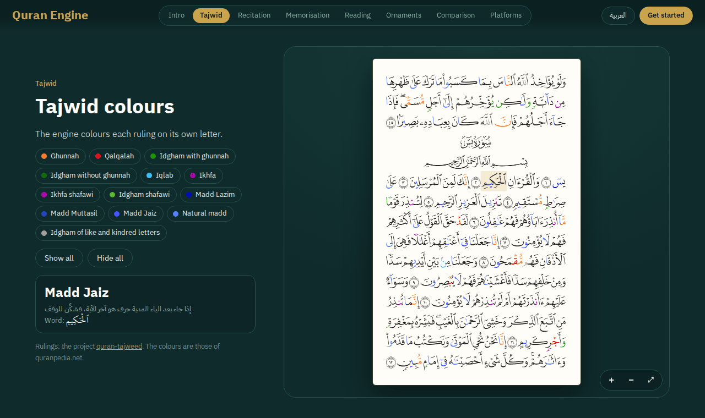

### Mushaf pages that an app can read, colour and touch, down to one letter.

Quran Engine draws each page of the mushaf as vectors with the platform's own graphics.
The page looks as it does in print, and the app can act on every word, letter and mark.

[العرض بالعربية](https://engine.quran.ws/) · [Documentation](https://quran.ws/docs/reference/quran-engine) · [npm](https://www.npmjs.com/package/@quran.ws/engine)

> **محرّك عرض صفحات المصحف.** يرسم Quran Engine صفحة المصحف كما طُبعت، ويتيح للتطبيق التعامل مع كل كلمة وحرف وعلامة فيها. [افتح العرض التفاعلي](https://engine.quran.ws/).

## What an app can do with it

| | |
|---|---|
| **Tajwid colours** | Colour each ruling on its own letter. |
| **Recitation** | Highlight the word, or the letter, that the reciter says. |
| **Memorisation** | Hide ayahs and show them word by word, by touch or by voice. |
| **Reading** | Zoom, reflow the lines for a small screen, and change paper and ink. |
| **Touch and search** | Know the word or letter under a finger. Search the text and select a range. |

Each of these runs in the [live demo](https://engine.quran.ws/?lang=en).

## Why use it

- **Sharp at every size.** The pages are lossless vectors of the printed mushaf.
- **Small.** The whole mushaf is 26 MB as one bundle, and the web engine is about 0.6 MB.
- **The same on every platform.** One Rust core computes the layout. Each platform draws it natively.

The demo compares it with page images, SVG files and fonts, and measures each on your device.

## Platforms

| platform | package |
|---|---|
| Web | `npm install @quran.ws/engine` |
| iOS and macOS | Swift package `QvpKit`, from this repository |
| Android | `packages/android` |
| Flutter | `packages/flutter` |
| React Native | `packages/react-native` |

The setup for each platform is in [the platform guide](https://quran.ws/docs/build/platforms).

## Documentation

| | |
|---|---|
| **Reference** | [quran.ws/docs/reference/quran-engine](https://quran.ws/docs/reference/quran-engine) |
| **Make words clickable** | [quran.ws/docs/build/clickable-words](https://quran.ws/docs/build/clickable-words) |
| **Work offline** | [quran.ws/docs/build/offline](https://quran.ws/docs/build/offline) |
| **How the engine works** | [`docs/HOW-IT-WORKS.md`](docs/HOW-IT-WORKS.md) |
| **The API** | [`docs/API.md`](docs/API.md) |
| **Page data and the CDN** | [`docs/DATA.md`](docs/DATA.md) · [`docs/CDN.md`](docs/CDN.md) |
| **The demo's source** | [`web/demo/`](web/demo/README.md) |

## Contribute

Issues and pull requests are welcome. [`CONTRIBUTING.md`](CONTRIBUTING.md) has the rules.

## Licence

The code is MIT. The page data has the terms of its source bundle:
[licensing in full](https://quran.ws/docs/reference/licensing).
